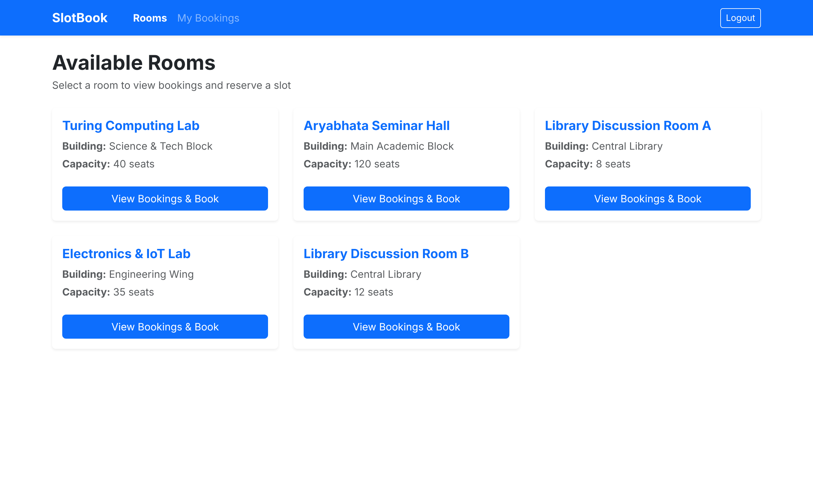
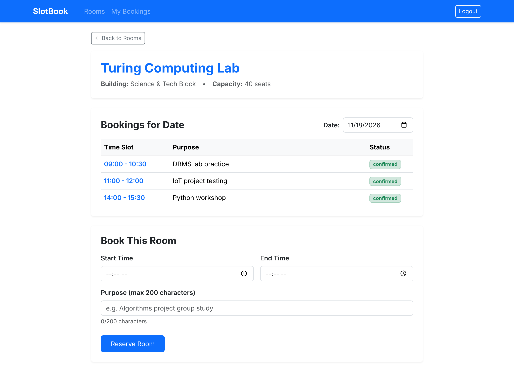
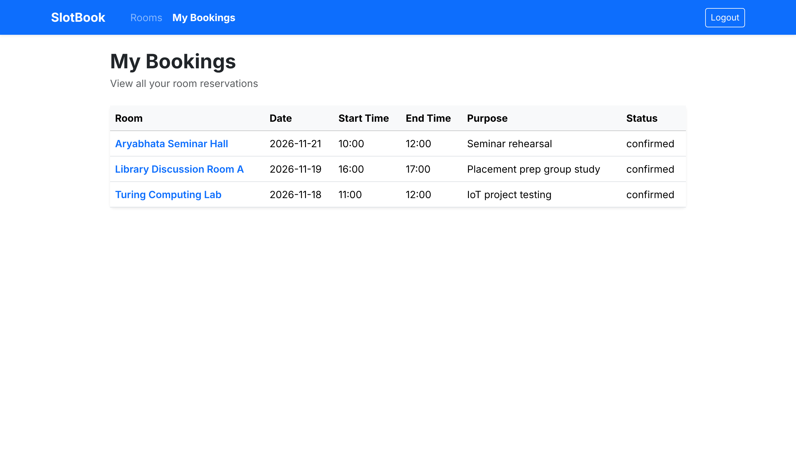

# SlotBook

SlotBook lets students book college rooms, such as a lab, seminar hall or library group room, for a time slot on a given day.

---

## Tech Stack

- **Backend**: Python 3.11+, FastAPI, SQLAlchemy 2, Pydantic v2
- **Database**: SQLite (`slotbook.db`)
- **Authentication**: Email + password, bcrypt hashing, JWT access token (PyJWT)
- **Frontend**: React 18, Vite, React Router, plain `fetch`
- **Styling**: Bootstrap 5
- **Testing**: pytest + FastAPI TestClient

---

## Features & Booking Rules

- **Strict Date & Time Formats**: Dates must be valid `YYYY-MM-DD` and times must be valid `HH:MM`. Times like `"9:00"` are automatically normalized and stored as `"09:00"`.
- **Opening Hours**: Rooms are open daily from `08:00` to `20:00`.
- **30-Minute Time Grid**: All bookings must start and end on 30-minute marks (e.g. `09:00`, `09:30`).
- **Duration Limits**: Bookings must last at least 30 minutes and at most 3 hours.
- **Past-Date Prevention**: Bookings in the past are prohibited based on India time (`Asia/Kolkata`).
- **Overlap Prevention**: Overlapping bookings for the same room on the same day are rejected with `409 Conflict`, indicating which slot is already taken. Back-to-back bookings (e.g. 10:00-11:00 and 11:00-12:00) are permitted.
- **Real-Time Sorting**: Both the Room day view and My Bookings sort slots by actual chronological time.

---

## Backend Setup (Windows)

1. Open PowerShell and navigate to the `backend/` directory:
   ```powershell
   cd backend
   ```

2. Create and activate a Python virtual environment:
   ```powershell
   python -m venv venv
   .\venv\Scripts\activate
   ```

3. Install dependencies:
   ```powershell
   pip install -r requirements.txt
   ```

4. Environment Variables:
   Settings come from environment variables with local defaults:
   - `SECRET_KEY`: JWT signing secret (default: `slotbook-secret-key-change-in-production`)
   - `DATABASE_URL`: Database connection string (default: `sqlite:///./slotbook.db`)
   - `TOKEN_MINUTES`: JWT token validity in minutes (default: `60`)
   - `CORS_ORIGINS`: Allowed CORS origins (default: `http://localhost:5173,http://127.0.0.1:5173`)
   - `ADMIN_PASSWORD`: Used by the seed script to set the initial admin password

5. Seed the database with 5 initial rooms and 1 admin user (`admin@college.edu`):
   ```powershell
   $env:ADMIN_PASSWORD = "adminsecret123"
   python -m app.seed
   ```
   > **Note**: To start fresh or clear existing test bookings, delete `slotbook.db` and run `python -m app.seed` again.

6. Start the FastAPI development server:
   ```powershell
   uvicorn app.main:app --reload
   ```
   The API will be running at `http://127.0.0.1:8000`. Interactive API documentation is available at `http://127.0.0.1:8000/docs`.

---

## Frontend Setup

1. Open a new PowerShell terminal and navigate to the `frontend/` directory:
   ```powershell
   cd frontend
   ```

2. Install dependencies:
   ```powershell
   npm install
   ```

3. Start the Vite development server:
   ```powershell
   npm run dev
   ```

4. Open your browser and navigate to:
   ```text
   http://localhost:5173
   ```

---

## Running Tests

All automated API tests are written with `pytest` and FastAPI `TestClient`. Tests run against an isolated in-memory SQLite database (`sqlite:///:memory:`) and **never** touch `slotbook.db`.

To run the test suite:

```powershell
cd backend
.\venv\Scripts\activate
pytest -v
```

All 17 test cases covering registration, login, token rejection, booking creation, time/date validation (422), duration limits, opening hours, past-date rejection, overlap prevention (409), back-to-back allowance, real-time sorting, and per-user booking isolation will execute.

---

## Screenshots

| Login | Rooms | Room day view | My bookings |
|:---:|:---:|:---:|:---:|
|  |  |  |  |

---

## Current Limits

- Bookings cannot be cancelled or changed.
- Every booking is confirmed straight away; there is no approval step.
- No recurring bookings.
- Rooms can only be added through the seed script.
