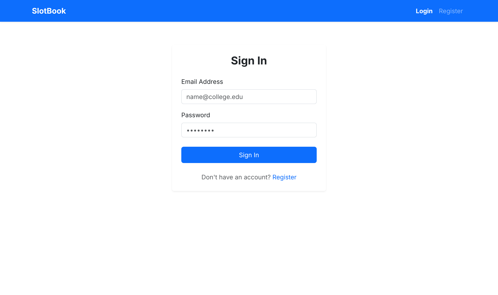

# SlotBook

SlotBook lets students and staff book college rooms, such as computer labs, seminar halls, and library discussion rooms, for specific time slots with real-time clash prevention, admin approvals, and recurring reservations.

---

## Tech Stack

- **Backend**: Python 3.11+, FastAPI, SQLAlchemy 2, Pydantic v2
- **Database**: SQLite (`slotbook.db`)
- **Authentication**: Email + password, bcrypt hashing, JWT access token (PyJWT)
- **Frontend**: React 18, Vite, React Router, plain `fetch`
- **Styling**: Bootstrap 5
- **Testing**: pytest + FastAPI TestClient

---

## Features & Booking Rules (Version 2)

- **Strict Date & Time Formats**: Dates must be valid `YYYY-MM-DD` and times must be valid `HH:MM`. Times like `"9:00"` are automatically normalized and stored as `"09:00"`.
- **Opening Hours**: Rooms are open daily from `08:00` to `20:00`.
- **30-Minute Time Grid**: All bookings must start and end on 30-minute marks (e.g. `09:00`, `09:30`).
- **Duration Limits**: Bookings must last at least 30 minutes and at most 3 hours (180 minutes).
- **14 Days Advance Window**: Bookings can only be scheduled up to 14 days in advance.
- **Past-Date & Time Prevention**: Bookings in the past are prohibited based on India Standard Time (`Asia/Kolkata`).
- **Clash Detection**: No two bookings for the same room on the same date may overlap if their status is `confirmed` or `pending`. Times are half-open: `10:00–11:00` and `11:00–12:00` do not clash. Overlaps return `409 Conflict` detailing the occupied slot. Check and insert happen in one transaction.
- **Daily Student Limit**: A student can hold at most 4 hours (240 minutes) of active (`confirmed` or `pending`) bookings per day across all rooms. Admins have no daily limit.
- **Cancellation Flow**:
  - Students can cancel their own bookings before start time (`date > today` or `date == today and start_time > now_india`).
  - Administrators can cancel any booking at any time.
  - Cancelled bookings immediately free the slot for other students and remain recorded in history with a `cancelled` badge.
- **Admin Approval for Large Rooms (Capacity 60+)**:
  - Bookings for rooms with capacity 60 or more start with `status = "pending"`.
  - Administrators review pending requests in the Admin Approvals dashboard (`/admin/approvals`) and can approve or reject them.
  - Approval re-checks for conflicting bookings before confirming to prevent race conditions.
- **Recurring Weekly Bookings**:
  - Users can select "Repeat weekly for N weeks" ($N$ from 2 to 8).
  - All dates are verified upfront (all-or-nothing transaction). If any date clashes with an existing reservation, nothing is saved and a `409 Conflict` response lists every clashing date.
- **Admin Room Management**:
  - Administrators can add new rooms (`POST /rooms`), edit existing room details (`PUT /rooms/{id}`), and close rooms (`POST /rooms/{id}/close`).
  - A room with future `confirmed` or `pending` bookings cannot be closed (returns `400 Bad Request`).
- **Real-Time Sorting**: Both the Room day view and My Bookings sort slots by actual chronological time.

---

## Backend Setup (Windows)

1. Open PowerShell and navigate to the `backend/` directory:
   ```powershell
   cd backend
   ```

2. Create and activate a Python virtual environment:
   ```powershell
   python -m venv venv
   .\venv\Scripts\activate
   ```

3. Install dependencies:
   ```powershell
   pip install -r requirements.txt
   ```

4. Environment Variables:
   Settings come from environment variables with local defaults:
   - `SECRET_KEY`: JWT signing secret (default: `slotbook-secret-key-change-in-production`)
   - `DATABASE_URL`: Database connection string (default: `sqlite:///./slotbook.db`)
   - `TOKEN_MINUTES`: JWT token validity in minutes (default: `60`)
   - `CORS_ORIGINS`: Allowed CORS origins (default: `http://localhost:5173,http://127.0.0.1:5173`)
   - `ADMIN_PASSWORD`: Used by the seed script to set the initial admin password

5. Seed the database with 5 initial rooms and 1 admin user (`admin@college.edu`):
   ```powershell
   $env:ADMIN_PASSWORD = "adminsecret123"
   python -m app.seed
   ```
   > **Note**: To start fresh, simply delete `slotbook.db` and run `python -m app.seed` again.

6. Start the FastAPI development server:
   ```powershell
   uvicorn app.main:app --reload
   ```
   The API will be running at `http://127.0.0.1:8000`. Interactive API documentation (Swagger UI) is available at `http://127.0.0.1:8000/docs`.

---

## Frontend Setup

1. Open a new PowerShell terminal and navigate to the `frontend/` directory:
   ```powershell
   cd frontend
   ```

2. Install dependencies:
   ```powershell
   npm install
   ```

3. Start the Vite development server:
   ```powershell
   npm run dev
   ```

4. Open your browser and navigate to:
   ```text
   http://localhost:5173
   ```

---

## Running Tests

All automated API tests are written with `pytest` and FastAPI `TestClient`. Tests run against an isolated in-memory SQLite database (`sqlite:///:memory:`) with `StaticPool` and **never** touch `slotbook.db`.

To run the test suite:

```powershell
cd backend
.\venv\Scripts\activate
pytest -v
```

All 33 test cases covering:
1. User registration & duplicate check
2. Login & JWT authentication (valid / 401 invalid)
3. Endpoint security without token (401)
4. Valid booking creation (201) & time normalization
5. Invalid date & time formats (422)
6. Opening hours (08:00 - 20:00) & 30-minute interval grid (422)
7. Duration constraints (min 30 mins, max 3 hrs) (422)
8. End time after start time rule (422)
9. Past-date and past-time prevention in India Standard Time (422)
10. Advance booking window (max 14 days ahead) (422)
11. Student daily limit (max 4 hours/day across all rooms) (422)
12. Admin exemption from daily booking limits
13. Overlap conflict rejection with slot details (409)
14. Back-to-back bookings allowance
15. Capacity 60+ approval workflow (`pending` initial status)
16. Admin approval & clash re-verification (409 on race condition)
17. Admin rejection workflow
18. Student cancellation of upcoming bookings before start time
19. Reopening/freeing slots upon booking cancellation
20. Cross-user cancellation protection (403)
21. Admin cancellation privileges
22. Recurring weekly bookings (2 to 8 weeks)
23. All-or-nothing transaction on recurring bookings with clashing date list (409)
24. Admin room management: creation, updates, and close restrictions
25. Real-time sorting for room day views and user booking history

---

## Screenshots

| Login | Rooms | Room day view | My bookings |
|:---:|:---:|:---:|:---:|
|  |  |  |  |

---

## Current Limits

- Email/SMS notifications are not yet implemented.
- Authentication currently uses two roles: `student` and `admin`.
- Bookings do not yet support automatic recurring cancellation (each recurring reservation is cancelled individually).
